<div align="center">


# Dannz AI Background & Image Studio

**Local-first AI background removal, batch processing and image editing — free, no accounts, no paid APIs.**

`Python (rembg / ONNX)` • `React + TypeScript + Vite` • `Tailwind CSS` • `Fabric.js canvas` • `PWA`

[Live Demo](#) · [Report an Issue](#) · [Vercel Deploy](#deployment)

</div>

---

## What it is

Dannz AI Studio is a professional-grade web tool that runs an open-source U²-Net / IS-Net
neural network to cut subjects out of photos. Everything that can happen on your machine
happens on your machine; only the actual AI inference has a (free) serverless path.

```
┌─────────────────────────── Browser (client-heavy) ───────────────────────────┐
│  Presentation    React 18 + Tailwind + design tokens, dark/light, EN/VI      │
│  Canvas          Fabric.js infinite workspace, pan/zoom 60-120 FPS           │
│  Adjustments     Brightness · Contrast · Saturation · Hue · Blur · Sharpen    │
│  Pipeline        composite · resize · crop · convert · compress · zip        │
│  Persistence     IndexedDB (images, results, settings, history, accounts)    │
└──────────────────────────────────────────────────────────────────────────────┘
│                                    │  POST /api/remove_bg
│                                    │  POST /api/fetch_image  (load image from URL)
│                                    ▼
┌─────────────────────────── Serverless (Python) ──────────────────────────────┐
│  Vercel Function   rembg + onnxruntime, warm ONNX session cache              │
│  Models            u2netp · u2net · isnet-general-use · u2net_human_seg · …  │
│  Status            GET /api/health  → model list + cache warm state          │
│  Remote fetch      server-side download, SSRF-hardened, never browser CORS   │
└──────────────────────────────────────────────────────────────────────────────┘
```

---

## Feature map

| Module | What you get |
|---|---|
| **Drag & Drop Uploader** | Drop anywhere in the window, or browse. Accepts JPG, PNG, WebP, GIF, BMP, TIFF. Global drag veil highlights the whole viewport. |
| **AI Background Removal** | One click cutout via ONNX Runtime. 5 models, max-edge cap (320–2400 px) for speed, optional alpha matting (foreground/background threshold + erode size) for hair and fur. |
| **Batch Processing** | Queue many files, run the pipeline sequentially with a live progress bar and per-file status (`pending` → `processing` → `done` / `failed`). Cancel mid-run. |
| **Manual Region Erase** | Draw rectangles directly on the cut-out for anything the AI left behind — each rectangle is stored in image pixel space, listed, individually removable, then applied with one click (result is committed as a new version). |
| **Comparison Grid** | Side-by-side *or* interactive before/after slider. Live stats: dimensions, size before, size after, bytes saved, processing time. |
| **Solid Background Composite** | Transparent, White, Black, Slate Gray or any custom HEX, composited on canvas before encode. |
| **Image Optimization** | Re-encode to PNG / JPG / WebP with a quality slider; JPEG/WebP flatten alpha onto white automatically. |
| **Smart Cropping & Resizing** | Exact pixel resize with optional aspect-ratio preservation, plus centre-crop to 1:1, 16:9, 4:3 or 3:2. |
| **Keyboard Shortcuts** | `Ctrl+Enter` process active · `Ctrl+Shift+Enter` process batch · `Ctrl+S` download ZIP · `1` / `2` / `3` switch view · `Ctrl+Z` / `Ctrl+Shift+Z` undo/redo in the workspace |
| **Dynamic Workspace** | Fabric.js canvas: scroll to zoom, drag to pan, Ctrl+Z / Ctrl+Y restore stack, floating glass toolbar. |
| **Non-Destructive Editing** | Adjustment sliders are re-applied as canvas filters, so nothing is baked in until you export. |
| **Layer Stack** | Base cutout layer listed with visibility, opacity, index and blend-mode reference. |
| **Presets** | Product Photo · Portrait · Cyberpunk · Cinematic · Clean Web — one click applies model, background, format and adjustments. |
| **Export Center** | Format, quality, scale (10–200 %) and background, with an on-canvas preview and single or ZIP download. |
| **Local Accounts** | Salted SHA-256 hashes in IndexedDB (Web Crypto). Export/import a `dannz-sync.json` to move settings between devices — no server database. |
| **History Log** | Timeline of uploads, processing runs, presets and exports, persisted across sessions. |
| **i18n** | Full English and Vietnamese dictionaries, switchable at runtime, including toast messages. |
| **Theme** | Dark by default, light "cream paper" variant. Persisted and applied before first paint (no flash). |
| **PWA** | Manifest, maskable icons, installable, offline shell with per-request cache strategy. |
| **Neural Scan overlay** | Processing stages (removing background → compositing → resizing → finalizing) with progress + cancel. |
| **Visual design** | Mica/glass panels with backdrop blur, glow-on-hover buttons, soft rounded edges and subtle borders over design tokens — dark plus cream light theme. |
| **Mobile-first layout** | Below 1024 px the shell reflows: tool strip becomes a horizontal rail, the right panel becomes a collapsible bottom sheet (auto-collapsed on the homepage so the hero is never covered), and the top bar compacts to icon-only controls. |

---

## Project structure

```
dannz-ai-studio/
├── api/
│   ├── remove_bg.py          # POST /api/remove_bg — AI background removal
│   ├── health.py             # GET /api/health — model list + cache state
│   ├── fetch_image.py       # POST /api/fetch_image — server-side image download for "load from URL"
│   ├── server.py             # local dev router for all three endpoints
│   └── requirements.txt      # rembg, onnxruntime, pillow, numpy
├── public/
│   ├── favicon.svg           # brand mark (vector)
│   ├── favicon.ico
│   ├── apple-touch-icon.png
│   ├── icon-192/512*.png     # + maskable variants
│   ├── manifest.webmanifest
│   ├── offline.html
│   └── sw.js                 # service worker (cache strategies)
├── scripts/
│   └── generate_icons.py     # regenerates every PNG/ICO from the SVG mark
├── src/
│   ├── assets/icons/         # 38 hand-written SVG icons (no emoji, no icon font)
│   ├── components/
│   │   ├── layout/           # TopBar · LeftSidebar · RightPanel · StatusBar · AppShell
│   │   ├── workspace/        # DropZone · ComparisonView · CanvasWorkspace · ProcessingOverlay
│   │   ├── panels/           # AIPanel · AdjustPanel · LayersPanel · PresetsPanel · HistoryPanel · RegionPanel
│   │   ├── batch/            # BatchQueue
│   │   ├── export/           # ExportModal
│   │   ├── auth/             # AuthModal
│   │   ├── settings/         # SettingsModal
│   │   └── ui/               # Icon · Modal · Toasts · Fields
│   ├── contexts/             # ThemeContext · LanguageContext · AuthContext · StudioContext
│   ├── hooks/                # useCanvas · useKeyboardShortcuts
│   │   └── (region drawing lives in StudioContext — single source of truth)
│   ├── services/             # api.ts · auth.ts · zip.ts
│   ├── styles/globals.css    # design tokens + @font-face + component classes
│   ├── i18n/index.ts         # en + vi dictionaries
│   ├── types/index.ts        # shared domain types + presets
│   ├── utils/                # storage (IndexedDB) · progress · toast · registerSW
│   ├── App.tsx
│   └── main.tsx
├── index.html
├── package.json
├── vercel.json              # framework/build/functions + security headers
├── vite.config.ts
├── tailwind.config.js
├── tsconfig.json
├── tsconfig.node.json
├── DEPLOY.md                # full Vercel deployment guide (from GitHub)
├── SECURITY.md
└── .env.example             # every optional API knob, commented
```

---

## Local setup

**Requirements:** Node 18+, Python 3.9+ (only if you want the API locally).

### 1 — One-click start (recommended)

The project ships with a launcher that starts **both** servers, waits for them
to be ready, and opens the browser:

```powershell
# PowerShell (from the project folder)
.\start-dev.ps1

# or double-click
start.cmd

# or through npm
npm start
```

```powershell
# stop both servers again
.\stop-dev.ps1      # or: stop.cmd / npm run stop
```

What the launcher does:

1. Checks Node/npm and Python, verifies `rembg` + `onnxruntime` are importable
   (and tells you the exact fix command if not)
2. Runs `npm install` automatically on the first run when `node_modules` is missing
3. Starts the Python API on `http://127.0.0.1:8000` and Vite on `http://localhost:3000`,
   writing logs to `.dev-logs/`
4. Waits until the ports actually answer, then opens `http://localhost:3000`
5. Safe to re-run — if a server is already listening it is reused instead of duplicated

Useful switches: `.\start-dev.ps1 -NoBrowser` (do not open the browser) and
`.\start-dev.ps1 -SkipApi` (frontend only, fastest boot).

### 2 — Install

```bash
git clone <your-repo-url>
cd dannz-ai-studio
npm install
```

### 3 — Frontend only (fastest start)

```bash
npm run dev          # http://localhost:3000
```

The app boots immediately. Without a running API the status dot turns red and
**all canvas features still work** — uploads, comparison, adjustments, presets,
resize, crop, format conversion, compression, export and ZIP.

### 4 — With the AI background-removal API

```bash
# terminal 1 — Python API (Vite proxies /api -> :8000 automatically)
npm run api:install
npm run api              # http://127.0.0.1:8000

# terminal 2 — frontend
npm run dev
```

The first request downloads the model weights (~5 MB for `u2netp`, ~170 MB for
`u2net` / `isnet-general-use`) into `~/.rembg/models` and stays warm afterwards.

> macOS/Linux Apple-silicon: if `onnxruntime` has no wheel for your Python, use
> Python 3.10–3.11, or `pip install onnxruntime-silicon`.

### 5 — Verify everything

```bash
npm run typecheck     # tsc --noEmit (app + node projects)
npm run build         # tsc && vite build → dist/
npm run preview       # serve the production build locally

curl http://127.0.0.1:8000/api/health
```

Optional extras:

```bash
npm run icons         # regenerate PNG/ICO brand assets with pure Python
npm run format        # prettier across src/
npm run lint          # eslint (bugs + hooks rules)
```

### 6 — Verify the API endpoints

```bash
curl http://127.0.0.1:8000/api/health
# {"status":"ok","models":["u2netp","silueta","u2net_human_seg"],"warm":true}

curl -X POST http://127.0.0.1:8000/api/fetch_image \
     -H 'Content-Type: application/json' \
     -d '{"url":"https://example.com/photo.jpg"}' -o photo.jpg
```

`/api/fetch_image` is what makes "load from URL" work: browsers cannot read
most cross-origin image responses (no `Access-Control-Allow-Origin`), and the
app runs with `connect-src 'self'`, so the download happens server-side. That
endpoint refuses non-`http(s)` URLs, URLs with credentials, non-trivial ports
(any HTTP method on a public host only), and any host that resolves into
private/loopback/link-local/metadata ranges — redirects are followed manually
and every hop re-validated. Responses are capped at 15 MB and their bytes must
be a real raster image.

---

## Deployment

### Vercel (recommended, free)

Hướng dẫn đầy đủ từng bước (Root Directory, biến môi trường, giới hạn, xử lý sự cố)
xem tại **[DEPLOY.md](./DEPLOY.md)**.

Tóm tắt: repo nằm trong thư mục con `dannz-ai-studio/`, nên khi import repo trên
Vercel phải đặt **Root Directory = `dannz-ai-studio`**. `vercel.json` khai báo sẵn:

```json
{
  "framework": "vite",
  "buildCommand": "npm run build",
  "outputDirectory": "dist",
  "functions": { "api/*.py": { "runtime": "python3.11", "maxDuration": 30 } }
}
```

Kết quả: static build trong `dist/` + 3 Serverless Function Python
(`/api/health`, `/api/remove_bg`, `/api/fetch_image`). `api/server.py` chỉ dùng để
chạy local nên không được deploy. Không cần biến môi trường để chạy mặc định.

No environment variables are required. Remember the platform limits — Python
functions get a **500 MB** bundle (the AI dependencies measure ~295 MB locally),
Hobby allows up to 300 s per invocation while `vercel.json` ships `maxDuration: 30`,
and the request body is capped at 4.5 MB:

| Limit | Value | How the app copes |
|---|---|---|
| Function runtime | 30 s (Hobby allows up to 300 s) | `u2netp` default + warm model cache + client-side pre-downscale to 1600 px; inference is serialised by a semaphore |
| Request body | 4.5 MB | `prepareForUpload()` re-encodes oversized images before upload |
| Model cold start | ~devtime | Weights cached in `/tmp` on the instance, session reused while it stays warm |
| URL import | network-bound | `/api/fetch_image` uses its own 15 s timeout and 15 MB cap, so a slow host can consume most of the budget |

### Any static host

Because the frontend is the whole app, the contents of `dist/` can be dropped on
Netlify, Cloudflare Pages, GitHub Pages or any object store. AI removal needs the
Python endpoints; point the frontend at them by changing `API_BASE` in
`src/services/api.ts`.

---

## Feature walkthrough

A guided tour of every feature, in the order you would use them.

### 1 — Landing: four ways in (drag, browse, paste, URL)

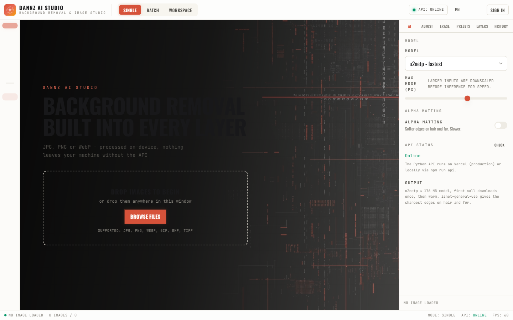

The empty state is the hub. The atmospheric video plate sits behind a
left-locked headline, and the drop panel accepts an image four ways:

| Route | How |
|---|---|
| **Browse** | Click *BROWSE FILES* — a single, predictable native picker |
| **Drag & drop** | Drop anywhere in the window; the whole viewport gets a dashed accent veil |
| **Paste** | Copy an image, then `Ctrl/Cmd+V` — the global paste handler reads the clipboard |
| **From URL** | Paste a link and press *LOAD* — downloaded server-side by `/api/fetch_image` so cross-origin CORS never blocks you |

Supported: JPG, PNG, WebP, GIF, BMP, TIFF. The uploaded image is processed
**immediately** — there is no second "run" click.

### 2 — Compare the cutout: side-by-side or slider

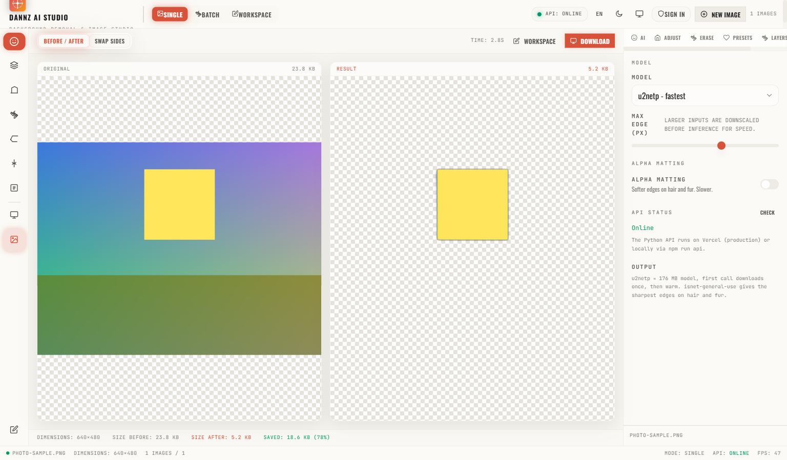

Two figure panes, *ORIGINAL* and *RESULT*, over transparency checkerboards,
with a live stats strip: dimensions, size before, size after and bytes saved.

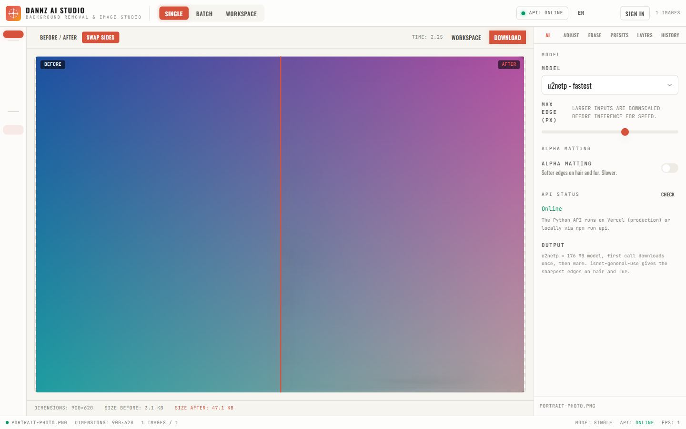

*SWAP SIDES* flips to an interactive before/after divider you can drag
anywhere across the canvas — handy for judging hair and fur edges.

### 3 — Choose the brain: model, max-edge, alpha matting

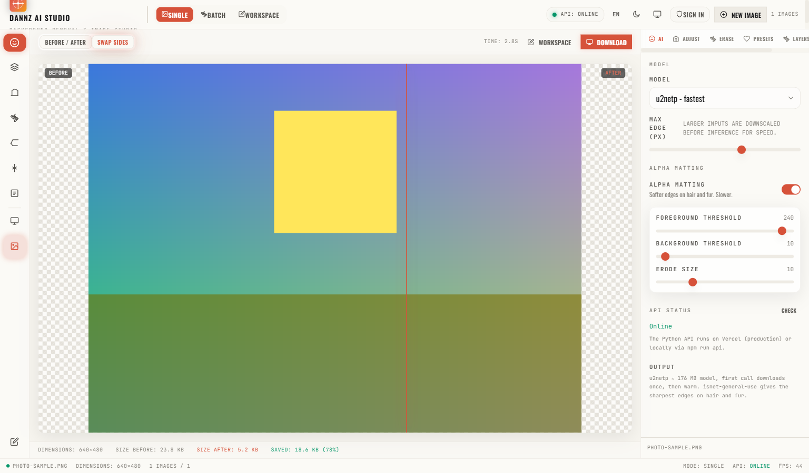

The **AI** tab controls the inference itself:

- **Model** — `u2netp - fastest` (default, ~5 MB download), `u2net - balanced`,
  `isnet - best quality` (176 MB), `u2net_human_seg - people`, `silueta - light`
- **Max edge (px)** — large inputs are downscaled before upload (320–2400 px),
  which keeps the serverless function inside its time budget
- **Alpha matting** — softer edges on hair and fur, slower. Expands into
  foreground threshold, background threshold and erode size for fine control
- **API status** — a live dot from `GET /api/health`, plus a *CHECK* button

### 4 — Adjust, re-encode, composite

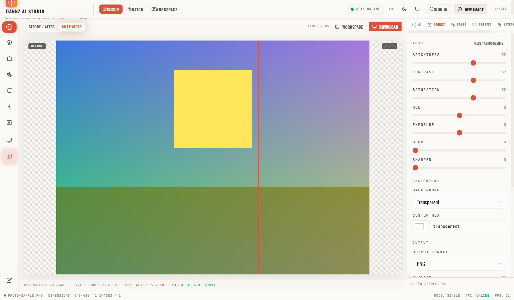

Non-destructive adjustments re-applied as canvas filters (nothing is baked in
until export): brightness, contrast, saturation, hue, blur, sharpen — plus a
background picker (transparent / white / black / slate / custom hex) and the
output format with a quality slider. JPEG and WebP flatten transparency onto
white automatically.

### 5 — One-click looks: presets

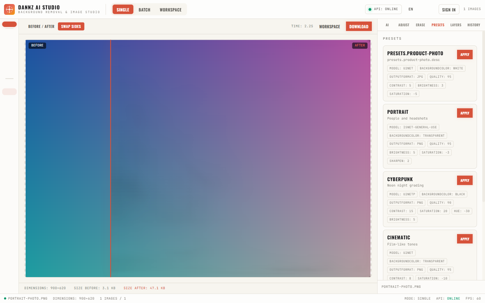

*PRODUCT PHOTO*, *PORTRAIT*, *CYBERPUNK*, *CINEMATIC* and *CLEAN WEB* each
bundle model, background, format and adjustments. One click applies the
whole stack; the chips under each card show what it changes.

### 6 — Clean up what the AI missed: manual region erase

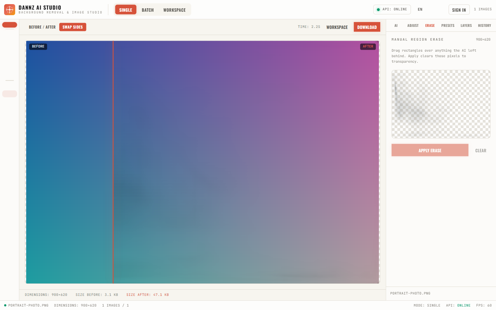

Paint rectangles directly on the cut-out to erase leftover background. Each
rectangle is stored in image-pixel space, listed in the panel, individually
removable, and applied with one click — the result is committed as a new
version, so the original stay intact.

### 7 — Infinite workspace: zoom, pan, layers

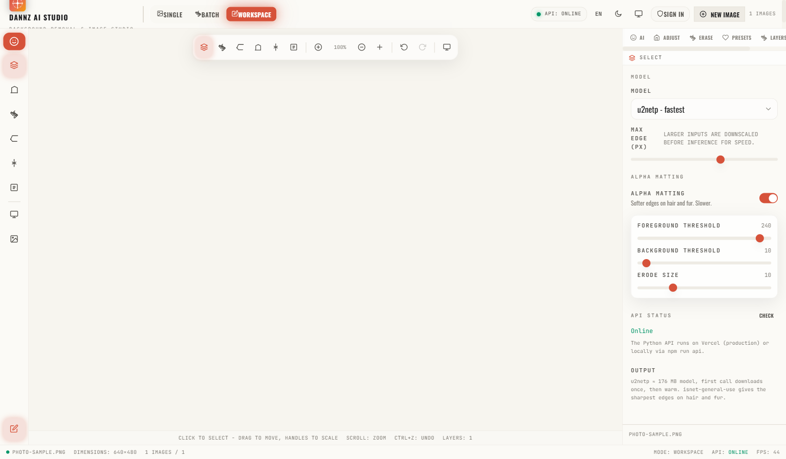

A Fabric.js canvas with a floating glass toolbar: select, crop, brush, eraser,
text and shape tools; scroll to zoom (the readout shows the current percentage),
fit-to-view, and a full `Ctrl+Z` / `Ctrl+Y` undo-redo stack.

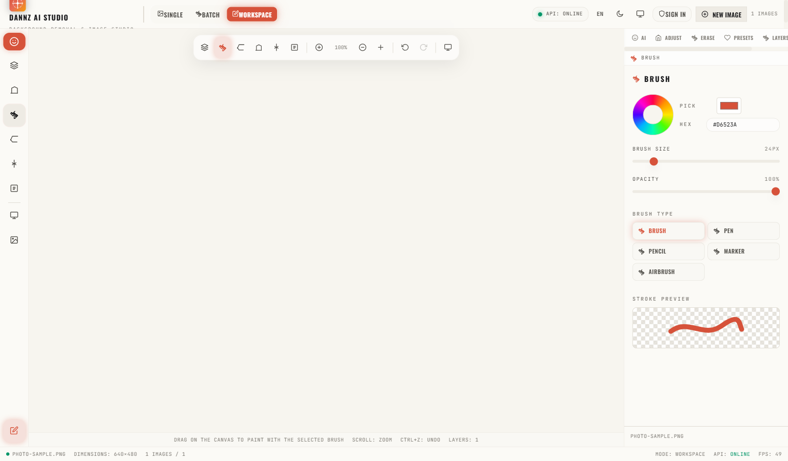

Every tool owns the right panel — here the brush panel with colour, size,
opacity, brush type (brush/pen/pencil/marker/airbrush) and a live stroke
preview.

### 8 — Layers

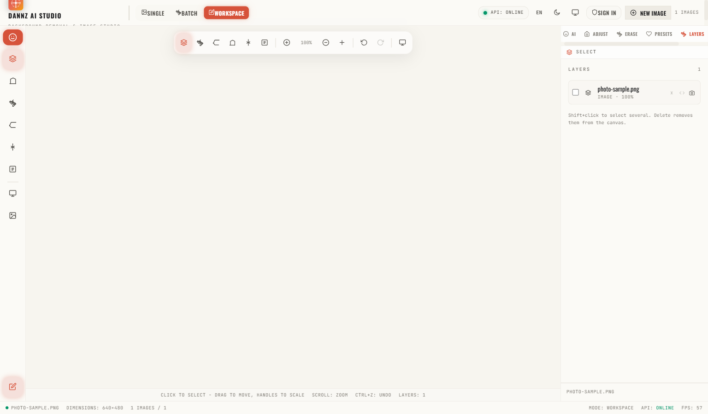

The base cutout layer is listed with visibility, opacity and move up/down
controls — the workspace is non-destructive, so nothing is destroyed until
you export or save.

### 9 — History

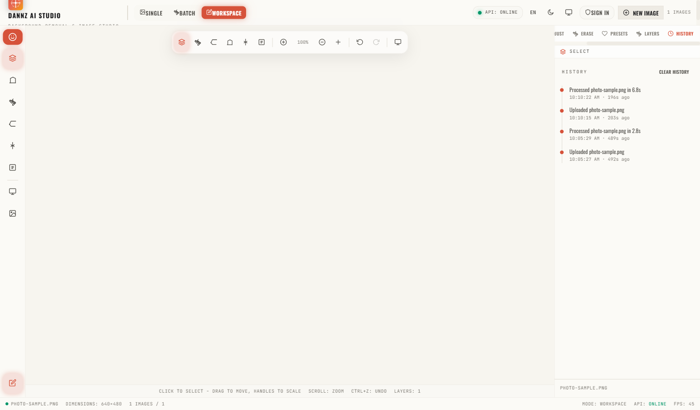

Every upload, processing run, preset apply and export is timestamped and
persisted in IndexedDB across sessions.

### 10 — Batch processing

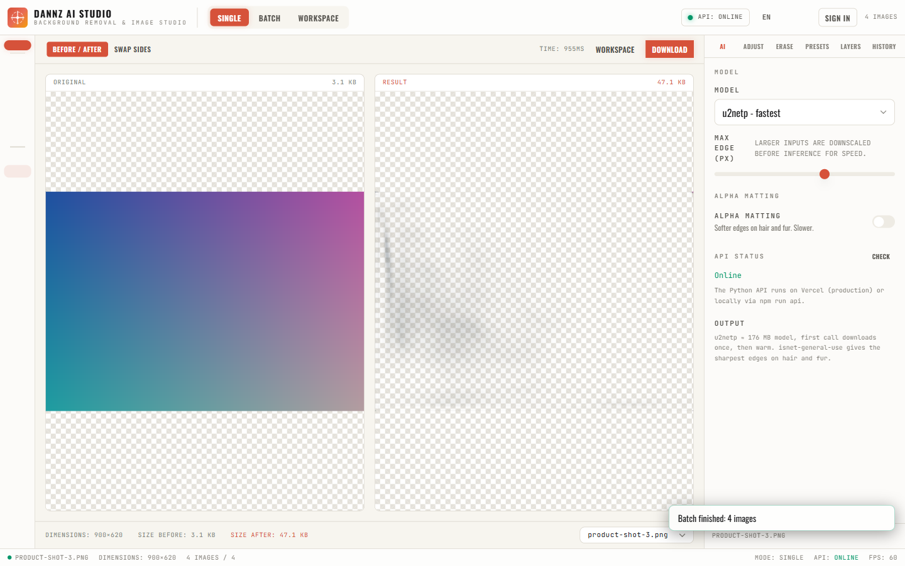

The queue lists every file with its own status chip
(`pending → processing → done / failed`), a live progress bar, cancel
mid-run, select-all, remove, and a *DOWNLOAD ZIP* action that packages
every finished cutout.

### 11 — Export center

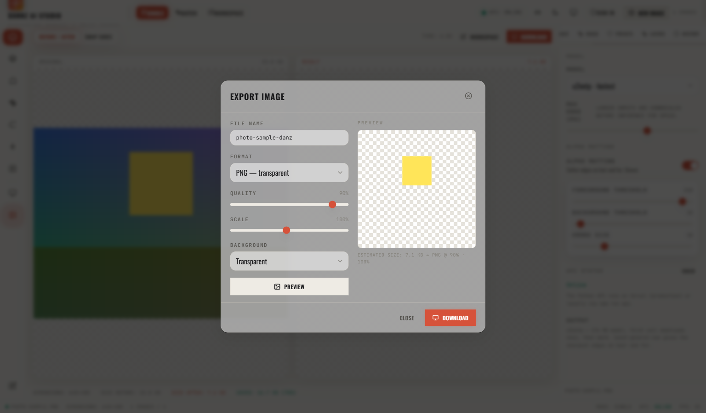

File name, format (PNG transparent / JPG smallest / WebP modern), quality,
scale 10–200 % and background — with an on-canvas checkerboard preview and
single download or ZIP.

### 12 — Local accounts and settings

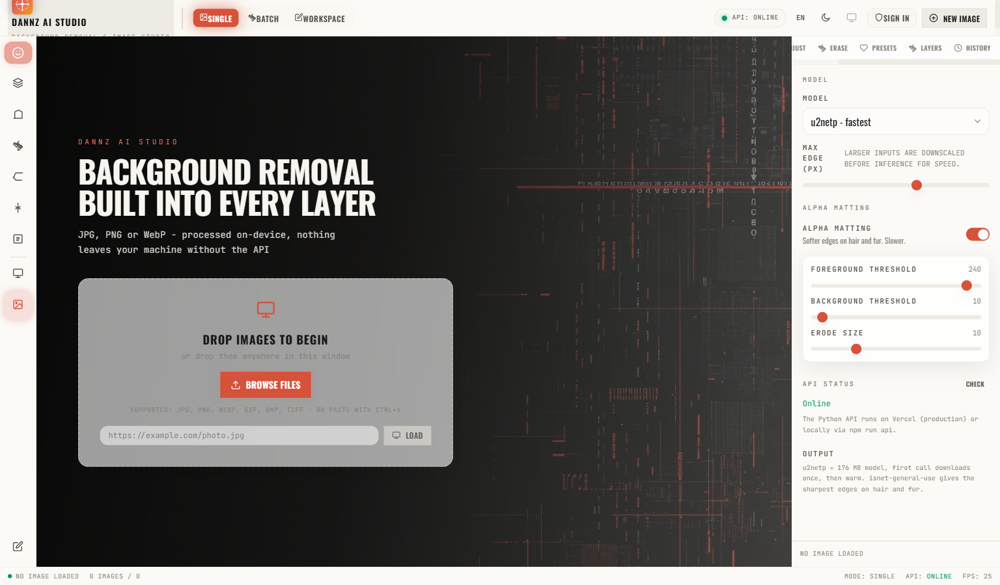

Accounts are local: username + password (salted SHA-256 via Web Crypto) stored
in IndexedDB. No server database, no email.

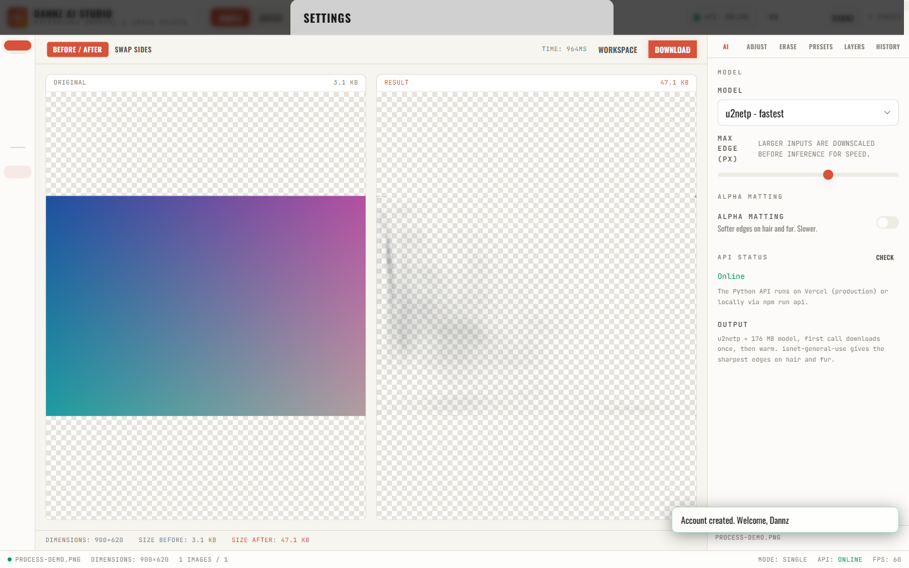

Settings holds the theme, language, account sync export/import
(`dannz-sync.json` to move settings between devices), clear-local-data and
the about block.

### 13 — Processing feedback: the Neural Scan overlay

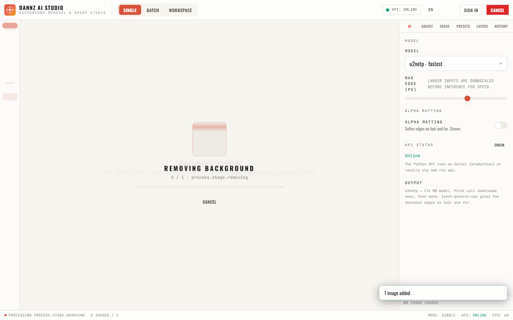

While the model runs, a scanline overlay names each stage (removing
background → compositing → resizing → finalizing) with progress and a
cancel button.

### 14 — Themes, languages, mobile

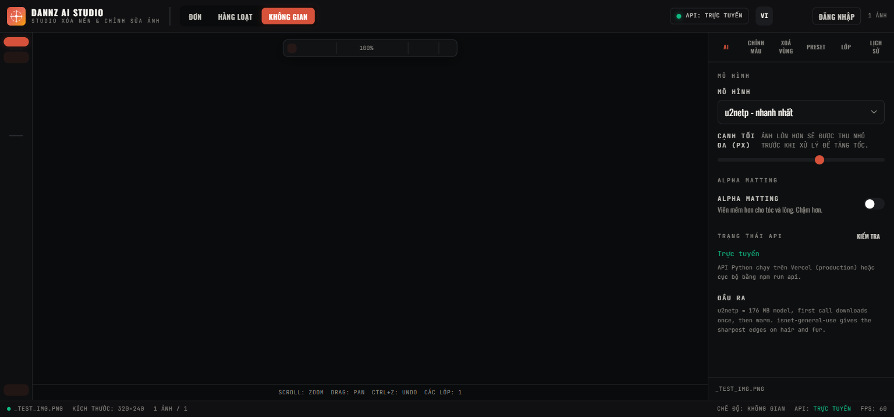

Dark by default, plus a cream-paper **light** variant — both persisted and
applied before first paint so there is no flash. The UI is also fully
localised in **English and Vietnamese**, switchable at runtime.

On phones and small desktop windows the layout reflows: the left tool strip
becomes a horizontal rail on top, the right panel becomes a collapsible
bottom sheet (it auto-collapses on the homepage so the hero is never
covered), and the top bar compacts to icon-only controls.

---

## Screenshots

All captures below are from the running app (dark theme unless noted).

| # | View | Preview | What it shows |
|---|---|---|---|
| 01 | Landing / empty state |  | The atmospheric video hero with the condensed headline and drag-drop panel. |
| 02 | Single comparison (side-by-side) |  | Original vs cutout in the two-up grid with the size/time stats strip. |
| 03 | Comparison (slider) |  | The draggable before/after divider mid-sweep. |
| 04 | AI panel |  | Model picker, max-edge slider, alpha matting expanded, API status dot. |
| 05 | Adjust panel |  | Brightness/contrast/saturation/hue/blur/sharpen + background + format + quality. |
| 06 | Presets |  | The five preset cards with their parameter chips. |
| 07 | Batch queue |  | Multi-file queue with per-file status chips and the ZIP action. |
| 08 | Region erase |  | The Erase panel where rectangles are drawn over leftover background. |
| 09 | Workspace canvas |  | Fabric.js canvas with the floating toolbar and zoom readout. |
| 10 | Workspace tools |  | The brush tool panel with colour, size, opacity and a live stroke preview. |
| 11 | Layers |  | Base cutout layer with visibility, opacity and reorder controls. |
| 12 | History |  | Timestamped timeline of uploads, runs, presets and exports. |
| 13 | Export modal |  | Format/quality/scale/background controls and the checkerboard preview. |
| 14 | Auth modal |  | Local account sign-in and creation. |
| 15 | Processing overlay |  | Neural Scan with the progress bar and cancel button. |
| 16 | Light theme |  | The cream-paper light variant (shown here in Vietnamese). |
| 17 | Settings / account |  | Theme, language, sync export, clear data, about block. |

```
docs/
├── 01-landing.png
├── 02-compare-side.png
├── 03-compare-slider.png
├── 04-ai-panel.png
├── 05-adjust-panel.png
├── 06-presets.png
├── 07-batch.png
├── 08b-region-erase.png
├── 09-workspace.png
├── 10-processing.png
├── 10-workspace-tools.png
├── 11-light.png
├── 11-layers.png
├── 12-settings.png
├── 12-history.png
├── 13-export.png
└── 14-auth.png
```

---

## Brand

- **Product:** Dannz AI Background & Image Studio (`Dannz AI Studio`)
- **Author:** Dannz
- **Wordmark:** Oswald ExtraBold, condensed uppercase, tight tracking
- **Accent:** `#D6523A` (signal red) · **Base:** `#0a0b0c` · **On-dark text:** `#F7F5EF`
- **Mono:** JetBrains Mono for every metric, status and label
- **Icons:** 38 hand-authored SVGs in `src/assets/icons/` — no emoji, no icon font
- **App icons:** `python scripts/generate_icons.py` rebuilds every PNG/ICO from `public/favicon.svg`

---

## Privacy

- No analytics, no trackers, no cookies, no third-party requests except Google Fonts and the hero video CDN.
- Uploaded images are held in memory and IndexedDB on the device. The only outbound
  transfer is the image you explicitly send to `/api/remove_bg`.
- Nothing is ever written to a database. "Accounts" are salted SHA-256 hashes stored locally.
- You can wipe everything from **Settings → Data → Clear local data**.

---

## Tech stack

| Layer | Choice | Why |
|---|---|---|
| UI | React 18 + TypeScript 5 | Strict types catch pipeline mistakes at build time |
| Styling | Tailwind CSS 3 + design tokens | Themeable via CSS variables, no runtime cost |
| Build | Vite 5 | Fast dev server, predictable chunking |
| Canvas | Fabric.js 5 | Infinite pan/zoom, object layers, filter stack |
| ZIP | @zip.js/zip.js | Streaming, dependency-light |
| Storage | IndexedDB (hand-rolled) | No `idb` dependency, persists large blobs |
| API | Python `http.server` | Zero framework — runs on Vercel and `python api/server.py` alike |
| AI | rembg + onnxruntime | Open weights, CPU inference, no API keys |

---

<div align="center">

**Dannz AI Background & Image Studio** — built by Dannz.

</div>
